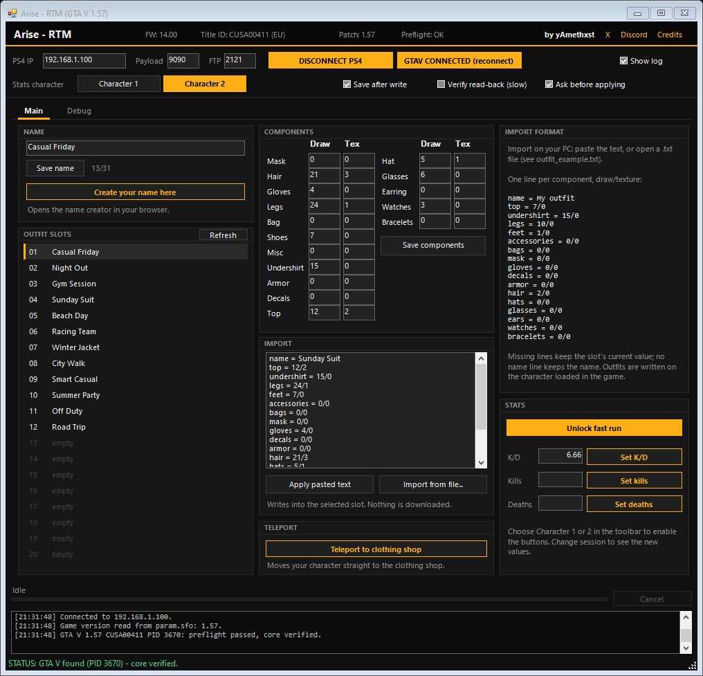
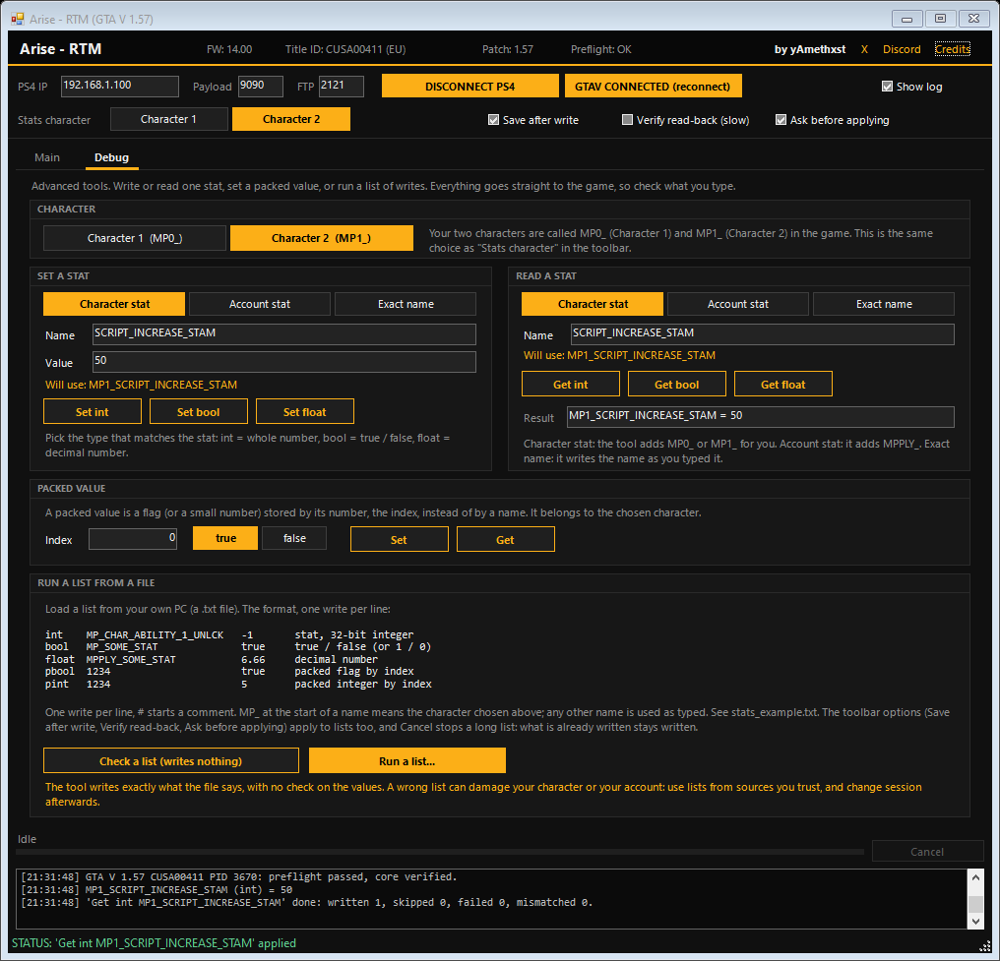

# Arise - RTM

Outfit editor, fast run unlock and custom K/D for **GTA V Online 1.57 on PS4**, run from your PC.

Made by **yAmethxst**: [X](https://x.com/yAmethxst) · [Discord](https://amethxst.dev/discord)





## Features

- **Outfit editor**: rename your saved outfits (31-byte limit), edit every component, and import an outfit from text or from a `.txt` file on your PC. The format is in `outfit_example.txt` and is also shown inside the tool.
- **Create your name**: the "Create your name here" button opens https://amethxst.dev/gta-name. Build the name there and paste it in the tool.
- **Teleport**: a button that moves your character straight to the clothing shop.
- **Fast run**: unlocks the permanent fast run on the character you choose.
- **Custom K/D**: set the K/D ratio, or the kills and deaths on their own.
- **Debug tab** (advanced): write or read any stat by name, set a packed value by index, or run a list of writes from a `.txt` file on your PC. Nothing is bundled: the tool writes only what you type or load. See below.

## Requirements

- PS4 on **firmware 14.00 or 14.02**, jailbroken with GoldHEN.
- GTA V **1.57**, EU (`CUSA00411`) or US (`CUSA00419`).
- A Windows PC on the same network as the console, with .NET Framework 4.8.1.

Tested on firmware 14.00 and 14.02 with GTA V 1.57 (EU).

## How to use

1. Make sure the PS4 is on firmware **14.00** or **14.02**.
2. On the console, open https://well0nez.github.io/afterglow-web/ and jailbreak it.
3. In GoldHEN, open **Server Settings** and enable **FTP** and **Payload Loader**.
4. Start GTA V.
5. Download `Arise-RTM-GTAV-PS4.zip` from the [Releases](../../releases) page and unzip it. Open `Arise - RTM.exe`, type the IP address of your PS4, then press **1. CONNECT PS4** and **2. CONNECT GTAV**.
6. Go online, then use the tool. If the outfit list is empty, press **Refresh**.

### Notes

- The outfit editor works on the character currently loaded in the game. Press **Refresh** after going online or after changing character.
- Fast run and K/D need **Character 1** or **Character 2** chosen in the toolbar: the buttons stay disabled until then. Change session to see the new values.
- Debug tab: values are written straight to the game, with no check. A wrong value or list can damage your character or your account, so use lists from sources you trust. "Check a list" reads a file and tells you what is in it without writing anything. A long list shows its progress and can be stopped with **Cancel**.
- `ps4debug.bin` is sent to the console automatically when it is not running yet.
- To look at the whole window without a console, start it with `--preview`. Nothing can be written in that mode.
- The FTP port is used only to read the game version from the console, so the tool can check that it is 1.57.
- Use it at your own risk.

## Debug tab

For advanced users. Values are written straight to the game, with no check, so a wrong value can damage your character or your account.

- **Character**: your two characters are called `MP0_` (Character 1) and `MP1_` (Character 2) in the game. Choose one at the top of the tab or in the toolbar: it is the same choice.
- **Set a stat / Read a stat**: type the name without the prefix, for example `CHAR_ABILITY_1_UNLCK`. *Character stat* adds `MP0_` or `MP1_` for you, *Account stat* adds `MPPLY_`, *Exact name* uses what you typed. The line "Will use" shows the full name. Pick the type that matches the stat: **int** is a whole number, **bool** is true / false, **float** is a decimal number.
- **Packed value**: a flag (or a small number) stored by its number, the index, instead of by a name. It belongs to the chosen character.
- **Run a list from a file**: a `.txt` file from your PC, one write per line (`stats_example.txt` shows it). **Check a list** reads it and tells you what is inside without writing anything. **Run a list** asks for confirmation, shows its progress and can be stopped with **Cancel**.

```
int    MP_CHAR_ABILITY_1_UNLCK   -1       a stat, 32-bit integer
bool   MP_SOME_STAT              true     true / false (or 1 / 0)
float  MPPLY_SOME_STAT           6.66     a decimal number
pbool  1234                      true     a packed flag by index
pint   1234                      5        a packed integer by index
```

`MP_` at the start of a name means the character you chose. Any other name is used as typed. `#` starts a comment.

## Credits

- **yAmethxst**: the tool. [X](https://x.com/yAmethxst) · [Discord](https://amethxst.dev/discord)
- **ps4debug-NG** by OpenSourcerer (OSR), maintained by Pharaoh2k: https://github.com/Pharaoh2k/ps4debug-NG. `ps4debug.bin` is v1.3.4 of this payload, licensed GPL-3.0. Its own thanks go to golden, Ctn, SiSTRo, DeathRGH and Pharaoh2k.
- **GoldHEN** by SiSTRo: https://ko-fi.com/sistro/shop
- **afterglow** by well0nez/m0zz: https://well0nez.github.io/afterglow-web/
- `libdebug`: the C# client library used to talk to ps4debug, by golden (jogolden): https://github.com/jogolden/ps4debug

Full details in [CREDITS.txt](CREDITS.txt).

## License

The code of this tool is under the [MIT License](LICENSE): use it and change it freely, but keep the copyright notice ("Copyright (c) 2026 yAmethxst") if you reuse it. The third-party material listed above keeps its own terms.

Grand Theft Auto, GTA, Rockstar Games and PlayStation are trademarks of their respective owners. This tool is not affiliated with or endorsed by Rockstar Games, Take-Two Interactive or Sony.
